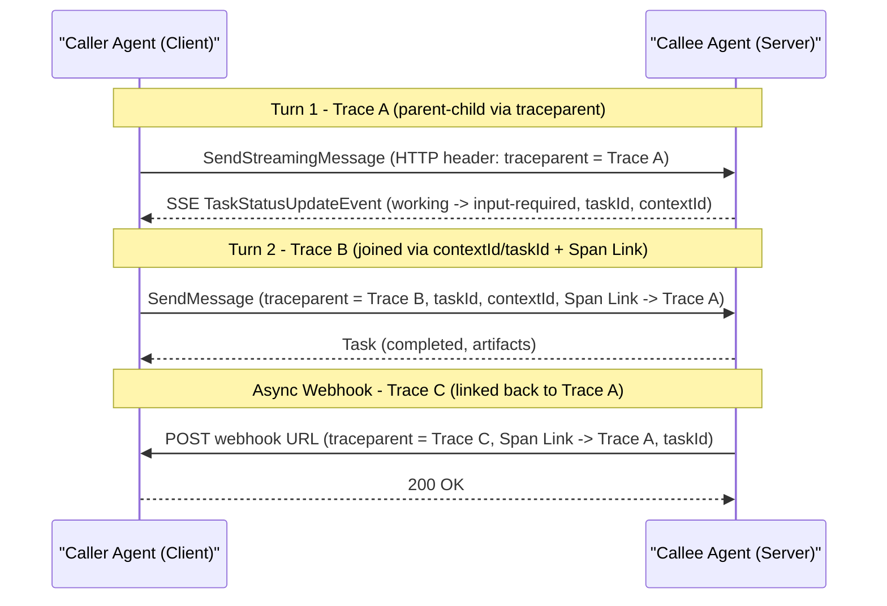

# Distributed Tracing

End-to-end tracing across Agent2Agent (A2A) calls relies on two distinct capabilities that are often conflated: **trace context propagation** (passing trace identity across the network from one agent to another) and **span emission** (recording and exporting the work each agent performs). If you emit spans without propagating context, each agent produces an isolated trace; if you propagate context without emitting spans, downstream calls leave a blind spot in the waterfall.

This guide covers both capabilities in A2A, followed by what callers and callees must do — including what popular agent frameworks wire up automatically and what you need to add yourself.

## 1. Trace Context Propagation

### What It Means in A2A

Trace context propagation passes the active trace identifier (`trace_id`), parent span identifier (`parent_span_id`), and sampling decision from a calling agent to a remote A2A agent. A2A [`Message`](../specification.md#414-message) and [`Task`](../specification.md#411-task) payloads do not define trace fields; instead, trace context travels in standard transport metadata using [W3C Trace Context](https://www.w3.org/TR/trace-context/). Keeping context at the transport layer lets agents written in different languages and frameworks join the same trace.

Each A2A protocol binding maps W3C Trace Context onto its native metadata envelope as shown below:

| Protocol Binding | Wire Carrier | Metadata Keys | Spec Reference |
| --- | --- | --- | --- |
| `HTTP+JSON` (REST) | HTTP request headers | `traceparent`, `tracestate` (optional), `baggage` (optional) | [Section 11](../specification.md#11-httpjsonrest-protocol-binding) |
| `JSONRPC` (including SSE) | HTTP request headers | `traceparent`, `tracestate` (optional), `baggage` (optional) | [Section 9](../specification.md#9-json-rpc-protocol-binding) |
| `GRPC` | gRPC request metadata (lowercase ASCII) | `traceparent`, `tracestate` (optional), `baggage` (optional) | [Section 10](../specification.md#10-grpc-protocol-binding) |
| Custom bindings | Transport envelope headers | W3C `traceparent` and `tracestate` key-value pairs | [Section 12](../specification.md#12-custom-binding-guidelines) |

Because A2A supports streaming, multi-turn pauses, polling, and webhooks, a single [`Task`](../specification.md#411-task) often spans multiple network requests. Rather than holding one span open while waiting on human input or background queues, propagate `traceparent` per request and connect separate turns using `contextId`, `taskId`, and OpenTelemetry [Span Links](https://opentelemetry.io/docs/concepts/signals/traces/#span-links).



The table below shows how context propagation applies across each A2A interaction mode:

| Interaction Mode | A2A Operations | How Context Propagates | Pitfall to Avoid |
| --- | --- | --- | --- |
| **Synchronous call** | [`SendMessage`](../specification.md#311-send-message) | Caller injects `traceparent`; callee extracts it and parents its server and executor spans under the caller's span. | Spawning background `asyncio` tasks or worker threads without copying the active OpenTelemetry context. |
| **SSE streaming** | [`SendStreamingMessage`](../specification.md#312-send-streaming-message), [`SubscribeToTask`](../specification.md#316-subscribe-to-task) | Caller injects `traceparent` on the initial `POST`; callee keeps the server span active until the SSE stream closes. | Closing the server span as soon as HTTP `200 OK` headers flush, which orphans spans emitted while streaming events. |
| **Multi-turn & polling** | Follow-up `SendMessage` (`input-required`, `auth-required`), [`GetTask`](../specification.md#313-get-task) | Each turn or poll starts a new trace with its own `traceparent`. Correlate turns via `contextId` and `taskId` attributes plus an optional Span Link to Turn 1. | Keeping a span open across minutes or hours of human wait time, which distorts latency metrics and hits trace timeouts. |
| **Push notifications** | [`CreateTaskPushNotificationConfig`](../specification.md#317-create-push-notification-config) + webhook `POST` | Callee stores the originating `SpanContext` with the `Task`, then attaches a Span Link and fresh `traceparent` when POSTing to the webhook URL. | Sending webhook `POST` requests without a Span Link or `taskId`, leaving webhook failures disconnected from the task. |

### How to Enable and Implement It

OpenTelemetry SDKs configure the W3C `TraceContext` and `Baggage` propagators by default (`OTEL_PROPAGATORS=tracecontext,baggage`). To move those headers across the wire, enable HTTP or gRPC transport auto-instrumentation on both ends — or inject and extract headers explicitly when you want scoped control:

```python
from opentelemetry import propagate

# Outbound (caller): write active traceparent (+ tracestate/baggage) into request headers
headers: dict[str, str] = {}
propagate.inject(headers)

# Inbound (callee): extract parent context from incoming HTTP/gRPC metadata
parent_ctx = propagate.extract(request.headers)
```

**Cross-organization hygiene:** When calling untrusted or third-party A2A agents across organizational boundaries, strip outbound `baggage` (or set `OTEL_PROPAGATORS=tracecontext`) at your client or egress proxy so internal session metadata does not leak to external endpoints.

## 2. Span Emission

### What It Means in A2A

Trace context propagation only carries an identifier across the wire; **span emission** is what creates timed records of work inside each agent and exports them to a tracing backend (such as Jaeger, Grafana Tempo, Google Cloud Trace, or Datadog). In an A2A system, spans come from two layers inside each process:

1. **A2A protocol spans** covering client transport calls (`SendMessage`, `SendStreamingMessage`, `GetTask`) and server request handling (`DefaultRequestHandler`, `AgentExecutor.execute`).
2. **Internal agent spans** covering the reasoning loop inside the agent (`invoke_agent`, model inference calls, and MCP or local tool executions).

Stamping consistent attributes on A2A spans lets operators filter traces by conversation, task state, or peer agent across heterogeneous frameworks. Where OpenTelemetry [Gen AI semantic conventions](https://opentelemetry.io/docs/specs/semconv/gen-ai/) define an attribute, prefer the standard key alongside A2A task fields:

| Attribute | Example Value | Where to Set | Purpose |
| --- | --- | --- | --- |
| `gen_ai.operation.name` | `"invoke_agent"` | Client & server agent spans | Marks the span as an agent invocation in Gen AI trace viewers |
| `gen_ai.agent.name` | `"Billing Agent"` | Client & server agent spans | Target agent's `AgentCard.name` |
| `gen_ai.conversation.id` | `"ctx-9f82c1..."` | Client & server spans | Maps to A2A [`contextId`](../specification.md#341-context-identifier-semantics) to group all turns in a conversation |
| `a2a.task.id` | `"task-4b10e8..."` | Client, server, & webhook spans | Maps to A2A [`taskId`](../specification.md#342-task-identifier-semantics) to join multi-turn resumes, polls, and webhooks |
| `a2a.task.state` | `"completed"`, `"input-required"` | Client & server spans | Final [`TaskState`](../specification.md#413-taskstate) observed when the RPC or stream finishes |
| `a2a.protocol.binding` | `"HTTP+JSON"`, `"JSONRPC"`, `"GRPC"` | Client & server transport spans | Selected A2A transport binding |
| `rpc.method` | `"SendMessage"`, `"SendStreamingMessage"` | Client & server transport spans | A2A RPC operation name |
| `server.address` | `"agents.example.com"` | Client spans | Remote host from the selected `AgentInterface.url` |

Because A2A agents are [opaque](./enterprise-ready.md) across trust boundaries, emitting spans does not expose an agent's internal steps to external callers. Which spans appear in a trace viewer depends on where each agent exports its telemetry:

| Deployment Boundary | What Appears in the Caller's Trace View | Why |
| --- | --- | --- |
| **Same trace backend** (single team or project) | Caller spans plus the callee's full internal LLM and tool span tree | Both agents export spans carrying the same `trace_id` to the same store |
| **Federated internal backends** (multiple teams in one enterprise) | Full cross-agent waterfall when queried via a federated trace scope; caller spans only otherwise | Spans share `trace_id`, while backend read permissions govern cross-team visibility |
| **External / third-party agent** (different organization or SaaS) | Caller's outbound client span only (latency, status, `taskId`, `contextId`) | The remote agent exports spans only to its own organization's backend |

**Payload privacy ([Section 13](../specification.md#13-security-considerations)):** Keep IDs (`contextId`, `taskId`), task states, timings, and error codes enabled by default, and keep `Message.parts` and `Artifact.parts` content **opt-in** so user prompts and business documents are not written to broadly readable trace stores unintentionally. Never record `Authorization` headers, API keys, OAuth tokens, or `TaskPushNotificationConfig.token` values on spans.

### How to Enable and Implement It

Enabling span emission requires two steps in each agent process: registering an OpenTelemetry `TracerProvider` with a span exporter, and enabling instrumentation for both the A2A SDK and your agent framework.

In Python, installing `a2a-sdk[telemetry]` activates built-in `@trace_class` spans on `JsonRpcTransport`, `RestTransport`, and `DefaultRequestHandler` (controlled by `OTEL_INSTRUMENTATION_A2A_SDK_ENABLED`, which defaults to `true`), and gives you `@trace_function` / `@trace_class` decorators for custom `AgentExecutor` methods:

```bash
pip install "a2a-sdk[http-server,telemetry]" \
  opentelemetry-sdk \
  opentelemetry-exporter-otlp
```

```python
from opentelemetry import trace
from opentelemetry.exporter.otlp.proto.http.trace_exporter import OTLPSpanExporter
from opentelemetry.sdk.resources import Resource
from opentelemetry.sdk.trace import TracerProvider
from opentelemetry.sdk.trace.export import BatchSpanProcessor

from a2a.server.agent_execution import AgentExecutor, RequestContext
from a2a.server.events import EventQueue
from a2a.utils.telemetry import SpanKind, trace_function

# 1. Configure a TracerProvider and OTLP exporter at process startup
provider = TracerProvider(resource=Resource.create({"service.name": "billing-a2a-agent"}))
provider.add_span_processor(BatchSpanProcessor(OTLPSpanExporter()))
trace.set_tracer_provider(provider)

# 2. Decorate custom executor work (SDK transport & handler spans emit automatically)
class BillingAgentExecutor(AgentExecutor):
    @trace_function(span_name="billing_agent.execute", kind=SpanKind.INTERNAL)
    async def execute(self, context: RequestContext, event_queue: EventQueue) -> None:
        span = trace.get_current_span()
        if context.context_id:
            span.set_attribute("gen_ai.conversation.id", context.context_id)
        if context.task_id:
            span.set_attribute("a2a.task.id", context.task_id)
        # Run your agent framework (ADK, LangGraph, etc.) here...
```

For a complete runnable setup exporting to Jaeger and Grafana, see the [`a2a_telemetry` sample](https://github.com/a2aproject/a2a-samples/tree/main/samples/python/agents/a2a_telemetry).

## 3. Caller and Callee Responsibilities & Framework Support

### What the Caller and Callee Must Do

For an A2A call to produce a single linked trace, the calling agent and the receiving agent each own half of the handshake. If either side skips its propagation or export step, the trace splits into two unlinked trees.

The table below summarizes the required responsibilities on each side:

| Step | Caller (A2A Client) Must Do | Callee (A2A Server) Must Do |
| --- | --- | --- |
| **1. Configure export** | Register a `TracerProvider` and span exporter (for example, OTLP). | Register a `TracerProvider` and span exporter (to the same or a federated backend). |
| **2. Emit spans** | Open a client/delegation span around the outbound A2A call and tag `gen_ai.agent.name`, `contextId`, and `taskId`. | Open a server span for the request, plus child spans for `AgentExecutor`, model calls, and tool calls. |
| **3. Propagate on the wire** | Inject W3C `traceparent` (and optional `tracestate`) into outbound HTTP headers or gRPC metadata. | Extract incoming `traceparent` from HTTP headers or gRPC metadata and attach it as the parent context before running the executor. |
| **4. Preserve async context** | On follow-up turns (`input-required`) or `GetTask` polls, tag `contextId` and `taskId` (and optionally add a Span Link). | Carry active context across internal `EventQueue` / worker tasks, and add a Span Link back to the stored `SpanContext` on webhook pushes. |

### What Popular Agent Frameworks Already Offer

Most agent frameworks emit rich spans for their internal LLM and tool loops, yet **do not automatically inject or extract HTTP `traceparent` headers on A2A calls**. Because A2A uses standard W3C headers, a caller in one framework (such as LangGraph) links cleanly into a callee in another (such as Google ADK) once any missing transport step is added.

The matrix below shows what popular frameworks and the A2A Python SDK handle out of the box today versus what you must wire manually:

| Framework / SDK | Span Emission (Internal Loop) | Caller `traceparent` Injection | Callee `traceparent` Extraction | What You Must Wire Manually |
| --- | --- | --- | --- | --- |
| **`a2a-sdk` (Python)** | **Built-in** via `a2a-sdk[telemetry]` (`@trace_class` on transports and `DefaultRequestHandler`) | **Manual** | **Manual** | Configure `TracerProvider` + exporter; add `HTTPXClientInstrumentor` (or a `ClientCallInterceptor`) on callers and `StarletteInstrumentor` / `FastAPIInstrumentor` on callees. |
| **Google ADK (`google-adk`)** | **Built-in** Gen AI spans (`invoke_agent`, `generate_content`, `execute_tool`) via `OTEL_EXPORTER_OTLP_*` or `otel_to_cloud` | **Manual** in OSS (`RemoteA2aAgent` emits `invoke_agent` span only; managed Agent Engine auto-instruments `httpx`) | **Built-in** with `adk api_server --a2a` / `adk web`; **Manual** with bare `to_a2a(agent)` | Call `HTTPXClientInstrumentor().instrument()` on callers using `RemoteA2aAgent`; wrap bare `to_a2a(agent)` Starlette apps with `StarletteInstrumentor`. |
| **LangGraph / LangChain** | **Built-in** via `opentelemetry-instrumentation-langchain` or `LANGSMITH_OTEL_ENABLED=true` | **Manual** | **Manual** (when self-hosting an A2A server) | Configure `TracerProvider` + LangChain OTel instrumentor; instrument outbound `httpx` / `requests` on callers and inbound Starlette/FastAPI on callees. |
| **OpenAI Agents SDK** | **Built-in** OpenAI traces; OTel export via `opentelemetry-instrumentation-genai-openai-agents` | **Manual** | **Manual** (`Runner.run` inherits ambient OTel context once extracted) | Install the OTel instrumentor + `TracerProvider`; instrument outbound `httpx` on callers and extract `traceparent` in ASGI middleware before `Runner.run()`. |
| **CrewAI** | **Built-in** via `opentelemetry-instrumentation-crewai` | **Manual** | **Manual** | Configure `TracerProvider` + CrewAI OTel instrumentor; instrument outbound HTTP clients, add inbound ASGI middleware, and copy OTel context into worker threads if using threaded tools. |
| **Claude Agent SDK** | **Opt-in** OTel spans via `CLAUDE_CODE_ENABLE_TELEMETRY=1`, `CLAUDE_CODE_ENHANCED_TELEMETRY_BETA=1`, and `OTEL_TRACES_EXPORTER=otlp` | **Manual** | **Partial** (reads `TRACEPARENT` env var per CLI/SDK session; HTTP servers need middleware) | Set the `CLAUDE_CODE_*` and `OTEL_*` env vars; instrument outbound HTTP tools and bridge inbound HTTP `traceparent` into the execution context. |

### Manual Wiring Recipes

Whenever your framework marks caller injection, callee extraction, or async queue handoff as **Manual** in the table above, drop in the corresponding pattern below.

#### 1. Caller: Inject `traceparent` on Outbound A2A Requests

You can either auto-instrument `httpx` globally or attach a per-client `ClientCallInterceptor` that writes W3C headers into `service_parameters` (which `a2a-sdk` forwards as HTTP headers or gRPC metadata):

```python
import httpx
from opentelemetry import propagate

from a2a.client.client import ClientCallContext, ClientConfig
from a2a.client.client_factory import ClientFactory
from a2a.client.interceptors import AfterArgs, BeforeArgs, ClientCallInterceptor

class TraceContextInterceptor(ClientCallInterceptor):
    """Injects W3C traceparent/tracestate into A2A transport headers per call."""

    async def before(self, args: BeforeArgs) -> None:
        if args.context is None:
            args.context = ClientCallContext()
        params = dict(args.context.service_parameters or {})
        propagate.inject(params)
        args.context.service_parameters = params

    async def after(self, args: AfterArgs) -> None:
        pass

def build_traced_a2a_client(agent_card):
    factory = ClientFactory(ClientConfig(httpx_client=httpx.AsyncClient()))
    return factory.create(agent_card, interceptors=[TraceContextInterceptor()])
```

*(If your framework constructs the A2A client internally — such as ADK's `RemoteA2aAgent` — call `HTTPXClientInstrumentor().instrument()` once at process startup instead.)*

#### 2. Callee: Extract `traceparent` on Inbound A2A Requests

Wrap your Starlette or FastAPI A2A application with OpenTelemetry's ASGI instrumentor (or a lightweight middleware calling `propagate.extract`) so every `AgentExecutor` run is parented to the caller's span:

```python
from starlette.applications import Starlette
from opentelemetry.instrumentation.starlette import StarletteInstrumentor

from a2a.server.request_handlers import DefaultRequestHandler
from a2a.server.routes import create_agent_card_routes, create_jsonrpc_routes
from a2a.server.tasks import InMemoryTaskStore

def build_traced_a2a_server(agent_card, agent_executor) -> Starlette:
    handler = DefaultRequestHandler(
        agent_executor=agent_executor,
        task_store=InMemoryTaskStore(),
        agent_card=agent_card,
    )
    app = Starlette(
        routes=[
            *create_agent_card_routes(agent_card),
            *create_jsonrpc_routes(handler, "/"),
        ]
    )
    # Extracts inbound `traceparent` and opens the parent SERVER span
    StarletteInstrumentor.instrument_app(app)
    return app
```

#### 3. Async Workers & Queues: Preserve Context Across Background Tasks

If your `AgentExecutor` dispatches work onto a detached `asyncio.Queue`, background task, or thread pool, capture the active context before handing off and re-attach it inside the worker so child LLM and tool spans do not break off into a new trace:

```python
import asyncio
from opentelemetry import context as otel_context

async def enqueue_background_step(queue: asyncio.Queue, payload: dict) -> None:
    # Capture active OTel context on the request coroutine
    await queue.put((otel_context.get_current(), payload))

async def worker_loop(queue: asyncio.Queue) -> None:
    while True:
        saved_ctx, payload = await queue.get()
        token = otel_context.attach(saved_ctx)
        try:
            # Child LLM and tool spans emitted here stay attached to the caller's trace
            await run_agent_step(payload)
        finally:
            otel_context.detach(token)
            queue.task_done()
```
